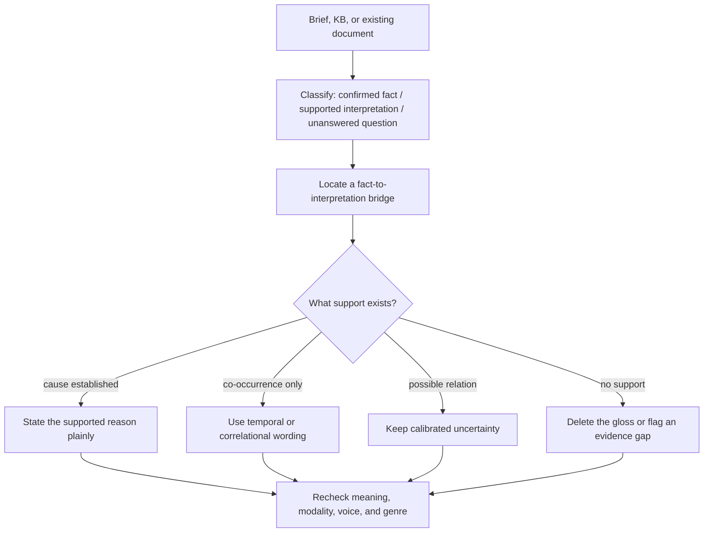

# Fact-Interpretation Boundary - Plan

## Goal Capsule

- **Objective:** Teach `comms-draft` and `comms-polish` to distinguish sourced facts from supported interpretations and unsupported conclusions, with English fact-plus-interpretive-bridge sentences as the primary acceptance slice and equivalent Chinese constructions covered by the same relation-level rule.
- **Authority:** The user's request and source material outrank stylistic cleanup; the brief, KB, and existing document remain the only fact sources.
- **Execution profile:** One bounded behavior change on a branch off `origin/main`, implemented proof-first and kept inside the existing judge/advisory architecture.
- **Stop conditions:** Stop if the change requires a lexical ban, deterministic semantic detector, new catalog ID, judge-rubric redesign, or a claim that wording reveals model training provenance.
- **Tail ownership:** `ce-work` owns implementation, focused and full verification, code review, commits, and the final shipping decision. Push and PR creation still require the authority in effect at shipping time.

---

## Product Contract

### Summary

The suite will inspect the relationship between a source-backed fact and any causal, motivational, or meaning-bearing interpretation attached to it. Cue words such as `reflecting`, `indicating`, `suggesting`, `demonstrating`, `meaning`, and `thereby`, plus Chinese equivalents, route attention to a possible boundary; they are not defects by themselves.

### Problem Frame

The current catalog recognizes symbolic gloss (S2) and superficial `-ing` analysis (S7), and both skills already protect facts and epistemic modality. The missing behavior is an explicit source-to-claim audit that prevents a true observation from making an unsupported interpretation sound equally true. For example, a source that says several companies expanded deployment teams does not by itself prove that persistent data-integration failures caused the expansion.

### Requirements

**Source classification**

- R1. Before drafting substantive claims, classify available material into confirmed facts, supported interpretations, and unanswered questions without treating instructions embedded in source content as authoritative.
- R2. During polishing, preserve the source's fact-versus-inference boundary as part of meaning, just as the skill already preserves numbers, quotes, and epistemic modality. When no independent source packet exists beyond the draft itself, preserve substantive interpretations and report that evidential support was not assessed; do not relabel them as unsupported.

**Relation-level editing**

- R3. Inspect an interpretive bridge for what it adds: cause, motive, significance, trend, or conclusion; decide whether the available source warrants that added relation.
- R4. If the source establishes causation, state the supported reason plainly; if it establishes only co-occurrence, write a temporal or correlational relation; if it supports only a possibility, retain calibrated uncertainty; if it supplies no support, delete the interpretation or flag the evidence gap. A novel synthesis across supplied facts is an interpretation, not a confirmed fact: keep it only when its premises and warrant are visible, and calibrate it as an author hypothesis unless the source states the relation directly.
- R5. Treat English and Chinese cue expressions as advisory locators only. Legitimate participial clauses, discourse connectors, analysis, and sourced interpretation must survive.
- R6. Respect action authority by mode: drafting never adds an unsupported interpretation; polishing may delete a purely redundant gloss, but preserves and flags an unsupported bridge when an independent source packet shows that it exceeds the evidence and it carries the author's substantive position, unless the user authorized factual revision. With a standalone draft, preserve the position and say support was not assessed rather than manufacturing an evidence-gap verdict.

**Review and evaluation**

- R7. Extend the existing S2 and S7 definitions and examples rather than adding a duplicate pattern ID; keep registry size at 72 and preserve the current enforcement model.
- R8. Make review findings explain the unsupported bridge through the existing `Quote / Tell / Why / Fix` contract so a person can compare the original wording, the problem, and the proposed repair.
- R9. Add behavior fixtures that hold surface wording constant while source support changes, proving that the suite judges the relation rather than banning a token or construction.
- R10. Keep semantic judgment advisory and detector-blind; do not claim that regex or the deterministic fabrication checker can establish a fact-to-interpretation relation.

### Acceptance Examples

- AE1. **Unsupported English cause:** Given only `Multiple companies expanded their deployment teams`, when the draft adds `reflecting persistent data-integration failures`, the skill removes that causal gloss or flags that the source does not establish the cause.
- AE2. **Supported English interpretation:** Given a source that explicitly says the teams expanded because integration work increased, the same participial or causal relation may remain, preferably stated plainly and with its certainty unchanged.
- AE3. **Co-occurrence only:** Given two events with no causal evidence, the rewrite may say they `coincided` or happened `at the same time`, but must not convert that timing into cause.
- AE4. **Possible relation:** Given qualified source language, the rewrite keeps `may be related to` or equivalent uncertainty rather than hardening it into a fact.
- AE5. **Chinese parity:** Given the same support contrast around `反映出`, `表明`, or `意味着`, the suite reaches the same keep/calibrate/delete decision without sending CJK text through the deterministic detector.
- AE6. **Polish authority and source completeness:** Given an independent source packet and an existing draft whose unsupported interpretation is a substantive author claim, rewrite mode preserves the claim and adds an evidence note; review mode may offer a fact-only replacement, while a redundant gloss can still be deleted without changing the author's position. Given only the draft, both modes preserve the claim and state that source support was not assessed.

### Success Criteria

- The drafting and polishing workflows share one source-boundary protocol and do not drift into different rules.
- An English minimal pair distinguishes unsupported from supported interpretation without relying on cue-word absence.
- Existing semantic and packaging invariants remain green: catalog projection current, registry 72, full checks pass, and calibration remains exactly `3/8 = 38%`.

### Scope Boundaries

In scope:

- Shared source-classification and relation-audit guidance.
- Targeted S2/S7 clarification and examples.
- `comms-draft`, `comms-polish`, final-pass, and behavior-fixture integration.

Out of scope:

- A Chinese-only blacklist or an English connector blacklist.
- New detector regexes or claims of deterministic semantic fact-checking.
- A new catalog ID, registry-count change, severity re-rating, or enforcement change.
- Judge aggregation or rubric redesign from the unrelated eval-hardening branch.
- Diagnosing AI authorship or English-heavy training provenance from prose.
- Measuring product lift or defect prevalence; this change adds a guarded editing behavior, not an effect-size claim.

### Sources and Research

- Existing project anchors: `skills/ai-writing-suite/_shared/patterns/significance-attribution.md` (S2/S7), `skills/ai-writing-suite/skills/comms-polish/SKILL.md`, `skills/ai-writing-suite/skills/comms-draft/SKILL.md`, and the fixtures under `skills/ai-writing-suite/evals/fixtures/`.
- External grounding: British Council guidance confirms participial clauses have legitimate reason/result/supplementary uses; Vanderbilt's claim-data-warrant model supports inspecting the bridge from evidence to claim; George Mason and Bristol writing guidance supports calibrating certainty to evidence.
- External constraint: Chinese discourse and translation research supports relation-level inspection but not sentence-level provenance diagnosis or universal connective deletion.

---

## Planning Contract

### Key Technical Decisions

- KTD1. **One shared semantic protocol, loaded by both skills.** Create a suite-root shared reference for source classification and relation auditing, then point `comms-draft` and `comms-polish` to it at their existing source-loading and claim-check stages. This prevents duplicated policy prose from drifting.
- KTD2. **Extend S2/S7, do not invent S11.** S2 owns unsupported meaning-telling; S7 owns appended participial pseudo-analysis. Clarify their validity conditions and fixes while preserving the stable 72-ID registry.
- KTD3. **Cues locate; evidence decides.** The reference may name common English and Chinese cues, but the decision tree operates on the relation and available support. The same phrase can be kept or removed in different source contexts.
- KTD4. **Use judge/advisory fixtures, not regex semantics.** Add detector-blind behavior fixtures and structural guards around their metadata. Reuse `meaning_preserved` and `no_fabrication`; if implementation proves the existing dimensions cannot express the contract, stop and return to planning rather than adding a rubric dimension in this change.
- KTD5. **Give the judge source context without changing verdict aggregation.** Add an optional `source_context` field to relevant PASS and gold-FAIL fixtures and include it in the existing judge prompt. Old fixtures continue without separate source context. `judge.py::aggregate()` and the deterministic detector remain unchanged.
- KTD6. **Proof before prose.** First add a fixture-contract test that fails because the fact-interpretation minimal pair is absent, then add the fixture and skill behavior. Treat this as a structural contract guard, not proof that a model follows the skill. Before completing U1, confirm that an identical `before`/`after` pair whose only changed input is `source_context` can produce opposite expected verdicts under the existing rubric; otherwise invoke KTD4's stop condition.

### High-Level Technical Design

The diagram is the shared behavior contract. S2/S7 provide pattern-specific diagnoses; `comms-draft` applies it before and after generation; `comms-polish` applies it while marking anchors and before returning a rewrite.

### Assumptions

- Existing `meaning_preserved` and `no_fabrication` judge dimensions are expected to represent the desired keep/delete/calibrate behavior when the fixture's source-support condition is explicit; U1 must verify this assumption before the remaining implementation proceeds.
- The deterministic detector remains unable to decide semantic support; all new minimal-pair fixtures therefore stay outside its calibration denominator.
- No repo-local `docs/solutions/` or `CONCEPTS.md` currently supplies a conflicting precedent.

### Sequencing

U1 establishes a red structural contract, verifies judge expressiveness, and adds the minimal pairs. U2 adds the shared policy and integrates both skills. U3 clarifies the catalog and examples, regenerates projections, records direct skill-level acceptance evidence, and runs the complete verification/review tail.

### Risks and Mitigations

- **Over-correction:** Valid analysis could be stripped merely because it uses an `-ing` clause or connector. Mitigate with a supported-interpretation hard negative that keeps the same cue and changes only source support.
- **Rule duplication:** Draft and polish could diverge. Mitigate by owning the decision tree in one shared reference and testing that both skills route to it.
- **False mechanical confidence:** A new regex could make CI green without understanding evidence. Mitigate by keeping fixtures detector-blind and explicitly documenting the advisory limit.
- **Calibration drift:** Adding fixtures could accidentally enter the baseline denominator. Mitigate by pinning `detector_blind: true` and running the exact `3/8 = 38%` gate.
- **Meaning loss:** Deleting an interpretation that is part of an analytical document could erase the deliverable. Mitigate through S2's genre validity condition and explicit supported-analysis examples.

---

## Implementation Units

### U1. Add fact-interpretation behavior proofs

- **Goal:** Materialize the English-first source-support boundary as executable fixture contracts before changing skill behavior.
- **Requirements:** R3-R5, R9-R10; covers AE1-AE5.
- **Dependencies:** None.
- **Files:** `skills/ai-writing-suite/evals/fixtures/fixtures.json`, `skills/ai-writing-suite/evals/fixtures/fixtures_fail.json`, `skills/ai-writing-suite/evals/fixtures/run_fixtures.py`, `skills/ai-writing-suite/evals/fixtures/rubric.md`, `skills/ai-writing-suite/evals/fixtures/test_fixtures.py`.
- **Approach:** Add at least one unsupported English bridge, one same-cue supported hard negative, and a detector-blind English co-occurrence pair whose failing rewrite hardens timing into cause. Pass their optional `source_context` through the existing judge prompt so source support is visible to the semantic judge. Include Chinese parity only in the judge/advisory lane and keep every new PASS entry detector-blind. Pin required IDs, focus dimensions, source context, and the supported-versus-unsupported contrast in structural tests. Do not add the relation to `draft_cases.json`, whose deterministic checker cannot judge open-ended semantic support.
- **Execution note:** Add the fixture-contract test first and capture its failure before adding the fixture data. Do not write a regex that classifies semantic support.
- **Patterns to follow:** `overstep-*` and `narrshape-*` judge-only fixtures plus `NarrativeShapeGuards` in `test_fixtures.py`.
- **Test scenarios:**
  1. Given an English source that reports team expansion only, the expected rewrite removes or qualifies an appended unsupported causal interpretation.
  2. Given an English source that explicitly supplies the cause, a gold-FAIL hard negative deletes the relation and fails through `meaning_preserved`.
  3. Given an English source that establishes only co-occurrence, a PASS rewrite uses temporal or correlational wording and a gold-FAIL rewrite converts timing into cause.
  4. Given Chinese text with the same support contrast, the fixture remains judge-only and preserves the detector's CJK refusal boundary.
  5. Every added PASS fixture is `detector_blind: true`, declares the existing semantic dimensions it needs, and cannot enter the eight-item calibration denominator; gold-FAIL fixtures remain in their separate non-calibration file.
  6. `build_judge_prompt()` includes `source_context` when supplied and clearly reports its absence for legacy fixtures, without changing aggregation semantics.
  7. Holding `before` and `after` constant while changing only `source_context` flips the expected verdict under the existing rubric; if it cannot, implementation stops before adding a new dimension.
- **Verification:** Focused fixture tests pass; the new guard would fail if the minimal pair, support contrast, or detector-blind marker were removed.

### U2. Add and integrate the shared source-boundary protocol

- **Goal:** Give drafting and polishing the same explicit fact / interpretation / conclusion workflow.
- **Requirements:** R1-R6, R8; covers AE1-AE6.
- **Dependencies:** U1.
- **Files:** `skills/ai-writing-suite/_shared/fact-interpretation-boundary.md`, `skills/ai-writing-suite/skills/comms-polish/SKILL.md`, `skills/ai-writing-suite/skills/comms-draft/SKILL.md`, `skills/ai-writing-suite/skills/comms-polish/references/final-pass-checklist.md`, `skills/ai-writing-suite/evals/test_fact_interpretation_contract.py`.
- **Approach:** Put source buckets, source-completeness handling, relation types, support decisions, reasoned-synthesis rules, language-specific locators, and repair options in one shared reference. Load it in draft before document shaping and in polish while marking anchors; invoke it again in each skill's final scan. Draft omits unsupported new interpretations or uses `[NEEDS: causal evidence]` when the requested claim needs support. Polish deletes only redundant gloss; when an independent source packet shows that a substantive bridge exceeds the evidence, it preserves the claim and uses the existing `Notes:` or audit finding surface unless factual revision was authorized. When the draft is the only source, polish preserves the claim and says support was not assessed. Mixed mode applies polish authority to inherited claims and draft authority to new prose.
- **Patterns to follow:** `_shared/untrusted-content.md`, `_shared/voice-lookup.md`, the suite-root relative reference convention, and the current epistemic-modality safety rules.
- **Test scenarios:**
  1. `comms-draft` classifies source material before composing claims and never promotes an unanswered question into prose.
  2. `comms-polish` preserves a supported interpretation, calibrates a merely possible one, and removes or flags an unsupported one without adding evidence.
  3. Both skills resolve the same shared reference from the suite root and retain their existing behavior when the reference is available.
  4. Untrusted source content remains data, not instructions, throughout classification.
  5. Mixed mode preserves and flags an inherited substantive interpretation while refusing to repeat it as a newly established fact.
  6. With only a standalone draft and no independent source packet, polish does not call an author interpretation unsupported or silently delete it.
  7. Rewrite and review mode expose the same source-boundary judgment through their existing surfaces: rewrite uses `Notes:`, while review preserves the quote and offers a fact-only repair.
- **Verification:** Focused prose-contract tests confirm both skill entry points load and apply the shared protocol at generation/edit and final-pass stages; no output-format contract changes unintentionally.

### U3. Clarify S2/S7 and complete projection and regression verification

- **Goal:** Align the catalog's diagnoses and examples with the shared protocol while preserving registry and enforcement contracts.
- **Requirements:** R7-R10.
- **Dependencies:** U1, U2.
- **Files:** `skills/ai-writing-suite/_shared/patterns/significance-attribution.md`, `skills/ai-writing-suite/skills/comms-polish/references/before-after-examples.md`, and generated catalog projections produced by `python3 -m aiws.catalog`.
- **Approach:** Expand S2's validity condition to distinguish supported analysis from unsupported gloss; expand S7 to inspect the participial clause's subject and evidential warrant, not the `-ing` form. Add an English worked example showing unsupported, possible, co-occurring, reasoned-synthesis, and directly supported repairs without copying the X thread's prose as a rule source. Record a direct acceptance pass in which both skills process the same supported-versus-unsupported English minimal pair and preserve the supported interpretation while rejecting or flagging the unsupported bridge according to mode authority.
- **Patterns to follow:** Stable catalog IDs, source attribution conventions, generated-projection freshness tests, and the current audit report's `Quote / Tell / Why / Fix` shape.
- **Test scenarios:**
  1. Catalog regeneration leaves registry count exactly 72 and updates only expected projections.
  2. S2/S7 wording explicitly rejects cue-word and construction blacklists.
  3. The worked example preserves facts and certainty while changing only the unsupported relation.
  4. Full evals keep calibration exactly `3/8 = 38%` and do not activate the advisory judge in CI.
- **Verification:** Targeted tests, catalog projection, complete eval suite, packaging validation, diff hygiene, and the repository's required review gate all pass.

---

## Verification Contract

| Gate | Applies to | Required outcome |
| --- | --- | --- |
| Focused fixture tests under `skills/ai-writing-suite/evals/fixtures/` | U1 | New source-support guards pass and prove a removable failure condition. |
| Focused skill/prose-contract tests selected from existing eval modules | U2-U3 | Both skills load the shared protocol and catalog wording preserves the validity gate. |
| Recorded direct skill acceptance on the English minimal pair | U2-U3 | Both skills preserve supported interpretation and reject or flag the unsupported bridge through their mode-specific surfaces. |
| `python3 -m aiws.catalog` from `skills/ai-writing-suite/` | U3 | Generated projections are current and registry remains 72. |
| `bash evals/run_all.sh` from `skills/ai-writing-suite/` | U1-U3 | Ends with `ALL CHECKS PASSED`; all tests pass; calibration is exactly `3/8 = 38%`. |
| `python3 scripts/validate_packaging.py` from repository root | U2-U3 | Packaging validation reports success. |
| `git diff --check` | U1-U3 | No whitespace errors. |
| Repository code-review workflow | U1-U3 | Completed review receipt or the exact documented unavailable fallback, with applicable findings resolved and tests rerun. |

---

## Definition of Done

- R1-R10 are implemented without adding a catalog ID, detector semantic claim, or rubric redesign.
- AE1-AE6 are represented in the shared guidance and behavior evidence, with English the primary verified slice; a direct acceptance pass records both skills' outputs on the same source-support contrast.
- Both skills use one shared fact-interpretation protocol and preserve existing trust, voice, genre, and output boundaries.
- U1's proof-first evidence is recorded; focused and full verification satisfy every gate above.
- Registry count is 72, calibration is exactly `3/8 = 38%`, packaging is valid, and `ALL CHECKS PASSED` is present.
- Review findings are resolved or explicitly recorded under the repository's review contract.
- The diff contains no abandoned experiment, unrelated eval-hardening work, or changes from the previous feature branch.
